# Intune Lookup Toolkit

**One web page for the bulk lookups Intune admins do every day — paste a list, get device IDs, object IDs, serials, primary users, user locations and group members, and copy exactly the column you need.**

[](https://github.com/exentis-tech/intune-lookup-toolkit/actions/workflows/ci.yml)


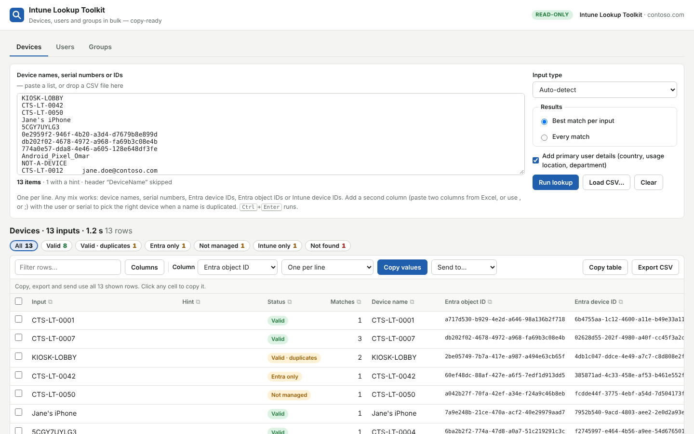

It replaces a folder of one-off PowerShell scripts (each with its own hard-coded credentials, CSV paths and output format) with three tools that share one results table:

| Tool | Paste | Get |
|---|---|---|
| **Devices** | Device names, serial numbers, Entra device IDs, Entra object IDs or Intune device IDs — mixed | Entra object ID, Entra device ID, Intune device ID, serial, primary user, ownership, OS, compliance, last check-in… and optionally the primary user's country, usage location and department |
| **Users** | UPNs, email addresses, display names or object IDs | Country, usage location, city, department, job title… — or every Intune device they're primary user of, with all three device IDs |
| **Groups** | Group names or object IDs | All (nested) user and/or device members, de-duplicated, with the groups each came from |

**Read-only.** The local server forwards only `GET` requests to a short allowlist of Graph endpoints. Nothing in the tenant can be changed through it.

## What you can do with the results

- **Status chips** — *Valid*, *Valid · duplicates*, *Entra only*, *Intune only*, *Not managed*, *Not found*… click one to filter (Ctrl+click for several).
- **Copy a column** — click ⧉ in any column header, or pick a column and *Copy values*. Unique values only, in the format you need: one per line, comma-separated, `'quoted','for','PowerShell'` or `"double","quoted"`.
- **Click any cell** to copy that value.
- **Select rows** (Shift+click for a range) to copy or export only those.
- **Copy table** (pastes straight into Excel) or **Export CSV**.
- **Send to…** another tool: e.g. group members → *Users → their devices* → *Devices* lookup.
- **Filter, sort, choose columns** — the column choice is remembered.
- **Load CSV…** or drag a CSV onto the input — pick the value column and an optional hint column.

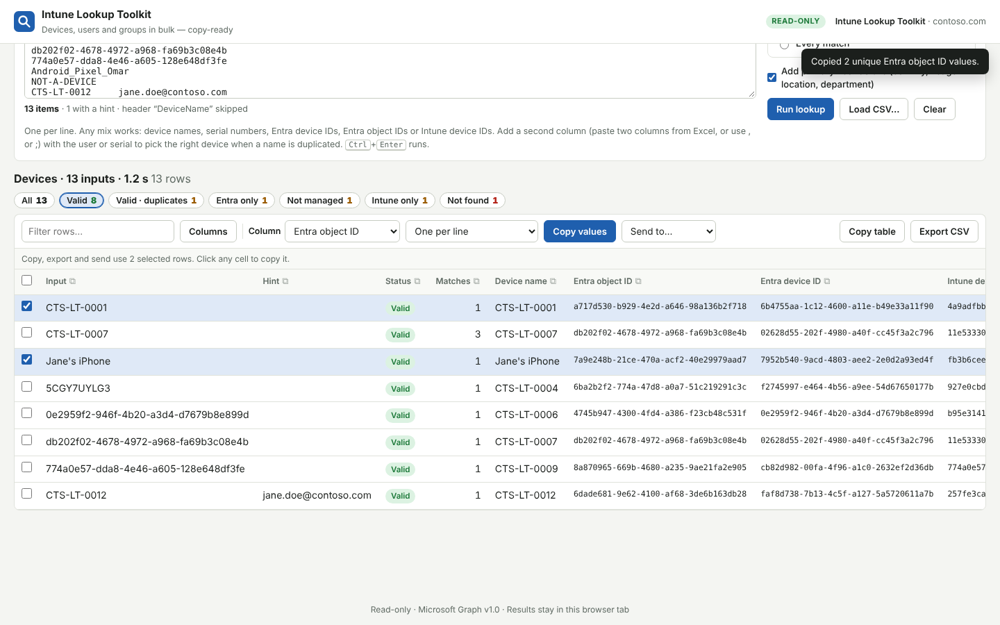

## Requirements

| | |
|---|---|
| **OS** | Windows 10/11 or Windows Server 2016+ (macOS / Linux with PowerShell 7) |
| **PowerShell** | Windows PowerShell 5.1 or PowerShell 7.2+ — no modules needed |
| **Browser** | Current Edge, Chrome or Firefox |
| **Network** | HTTPS to `login.microsoftonline.com` and `graph.microsoft.com` (proxy supported) |
| **Entra ID** | An app registration with a client secret and these **application** permissions, admin-consented |

Full details: [docs/REQUIREMENTS.md](docs/REQUIREMENTS.md)

| Graph application permission | Used for |
|---|---|
| `DeviceManagementManagedDevices.Read.All` | Intune devices (IDs, serials, primary users, OS, compliance, check-in) |
| `Device.Read.All` | Entra devices (object IDs, device IDs, join type, sign-in) |
| `User.Read.All` | Users, locations and departments |
| `GroupMember.Read.All` | Group members (`Group.Read.All` or `Directory.Read.All` also work) |

If your existing scripts already ran with an app registration, it most likely has these. The server prints the permissions it received at startup and warns about missing ones.

## Quick start

```powershell
cd C:\Tools\intune-lookup-toolkit
Copy-Item config.example.json config.json
notepad config.json          # TenantId, ApplicationId, ClientSecret
.\Start-Lookup.cmd           # or: pwsh ./server.ps1
```

The browser opens on **http://127.0.0.1:8089/**. Keep the window open while you work; Ctrl+C stops it.

```
  Intune Lookup Toolkit  v1.0.0  (read-only)

[17:56:12] Config:        C:\Tools\intune-lookup-toolkit\config.json
[17:56:12] Tenant:        contoso.onmicrosoft.com
[17:56:12] Application:   11111111-2222-3333-4444-555555555555
[17:56:12] Signed in as:  Intune Lookup Toolkit
[17:56:12] Permissions:   DeviceManagementManagedDevices.Read.All, Device.Read.All, User.Read.All, GroupMember.Read.All
[17:56:12] Mode:          read-only - this tool never changes anything in the tenant.
[17:56:12] Open:          http://127.0.0.1:8089/
```

No tenant at hand? Serve the folder (`python -m http.server`) and click **Try the demo tenant**.

Step-by-step app registration and troubleshooting: **[docs/SETUP.md](docs/SETUP.md)** · every screen and recipe: **[docs/USER-GUIDE.md](docs/USER-GUIDE.md)**

### config.json

Same format as the Intune App Decommission tool, so one file can serve both (they use different ports by default).

| Key | Default | Meaning |
|---|---|---|
| `TenantId` | — | Tenant ID or primary domain |
| `ApplicationId` | — | App registration (client) ID |
| `ClientSecret` | — | Client secret, or leave it out and set the `IAD_CLIENT_SECRET` environment variable |
| `GraphBaseUrl` | `https://graph.microsoft.com/v1.0` | Change for national clouds |
| `GraphBetaBaseUrl` | `https://graph.microsoft.com/beta` | Not used by this tool; accepted for compatibility |
| `AuthorityHost` | `https://login.microsoftonline.com` | *Optional*, for national clouds |
| `ListenPrefix` | `http://127.0.0.1:8089/` | Local address. Must be loopback |
| `AllowedOrigin` | empty | Only for a front end on another origin. `*` is ignored on purpose |
| `RequestTimeoutSeconds` | `60` | Timeout per Graph call |
| `ProxyUrl` | empty | Outbound proxy, e.g. `http://proxy.corp:8080` |
| `UseDefaultProxyCredentials` | `false` | Authenticate to the proxy as the current Windows user |

`config.json` and `*.csv` are git-ignored. Never commit or share a client secret; rotate it if it leaks.

## Devices — how matching works

Paste anything, one per line. With **Auto-detect**, GUIDs are tried as Entra object ID, Entra device ID and Intune device ID; other values as device name (Entra and Intune) and serial number. Every Intune record is then linked to its Entra object through `azureADDeviceId = deviceId`.

When several records match (re-imaged devices, stale objects, duplicate names), they're ranked:

1. matches the **hint** (second column: serial number or primary user),
2. actively **managed** in Intune,
3. Entra and Intune **linked**,
4. Entra object **enabled**,
5. most recent **check-in** / sign-in.

*Best match per input* shows the winner with *Matches* and a *Note* explaining the choice; *Every match* lists them all.

| Status | Meaning |
|---|---|
| **Valid** | Entra object linked to an actively managed Intune device |
| **Valid · duplicates** | Several valid matches; the best is shown — add a hint to choose |
| **Not managed** | Intune record exists but isn't actively managed (retire / wipe pending) |
| **Entra only** | Entra device with no Intune record |
| **Intune only** | Intune device with no Entra object |
| **Not found** | Nothing matches |
| **Invalid input** / **Error** | Value isn't valid for the chosen type / a Graph call failed |

Filtering on **Valid** reproduces the old "complete" CSV; everything else is the old "not found / invalid" CSV.

## Replaces your one-off scripts

| Typical script | Now |
|---|---|
| Entra device ID → Entra object ID, only if actively managed in Intune | **Devices** → chip *Valid* → copy *Entra object ID* |
| Device name or serial → object ID | **Devices** |
| Device name → ownership, OS, last check-in, best match by serial / user | **Devices** + hint column |
| Device name + primary user → object ID | **Devices**, paste two columns |
| Device → primary user's country | **Devices** + *Add primary user details* |
| UPN → country, usage location | **Users** → *User details & location* |
| Emails → their Intune devices | **Users** → *Their Intune devices* |
| Groups → nested users and emails | **Groups** → copy *Email or UPN* |

What it does better than a folder of scripts:

- **No credentials in code** — one `config.json` (or an environment variable), read by one local process.
- **Serial numbers are looked up in Intune**, where they live — not against the Entra display name.
- **Any ID type works anywhere** — Entra object IDs, Entra device IDs and Intune device IDs are each sent to the endpoint that knows them.
- **No row-aligned files** — the device and its hint sit on the same line instead of two CSVs that must stay in the same order.
- **Fast** — 20 requests per `$batch`, paging, and automatic retry on throttling instead of one or two calls per row.
- **Apostrophes and special characters** are escaped in every query.

## Security

- The client secret stays in the PowerShell process; the browser never receives it or the Graph token.
- Listens on loopback only; rejects foreign `Host` and `Origin` headers; every call needs a per-start session token.
- **Read-only allowlist**: `GET` on `/devices`, `/users`, `/groups`, `/organization` and `/deviceManagement/managedDevices` only; `$batch` may contain only those reads. Everything else is refused.
- Serves only the UI files — never `config.json`, scripts or tests.
- Results live only in the browser tab; nothing is written to disk unless you export.
- Application permissions are tenant-wide: protect `config.json` like an admin credential.

## Project layout

```
server.ps1            Local read-only backend: config.json, app-only token, Graph proxy
Start-Lookup.cmd      Windows launcher
config.example.json   Copy to config.json
index.html, css/      UI
js/app.js             Tools, input, CSV import
js/lookups.js         Device / user / group lookup logic
js/table.js           Results table: filter, sort, copy, export, send-to
js/graph.js           Graph client: batching, paging, retries
js/mock.js            Demo tenant (also used by the tests)
tests/                Unit tests and end-to-end server tests
```

```bash
npm test                 # lookup logic against the demo tenant
npm run test:server      # server.ps1 end to end (needs pwsh, or PWSH=powershell)
```

## Screenshots

| | |
|---|---|
| 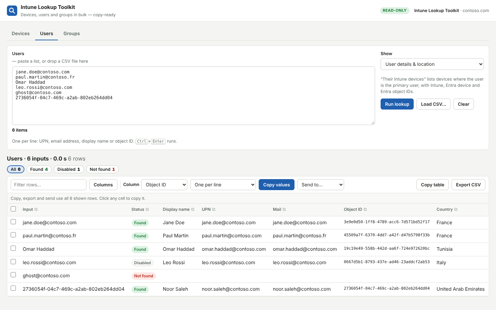 **Users — location and department** | 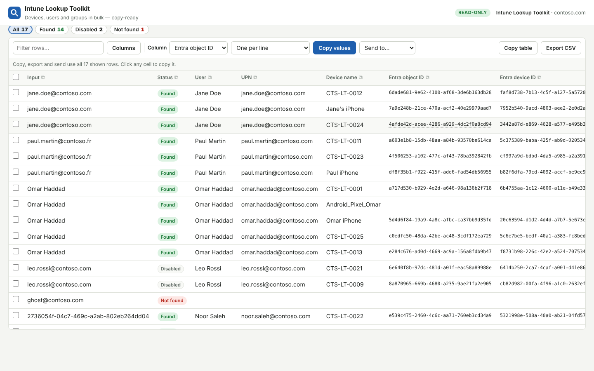 **Users — their devices with every ID** |
| 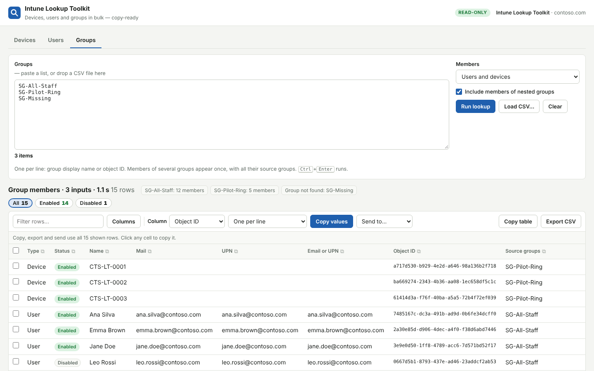 **Groups — nested members, de-duplicated** | 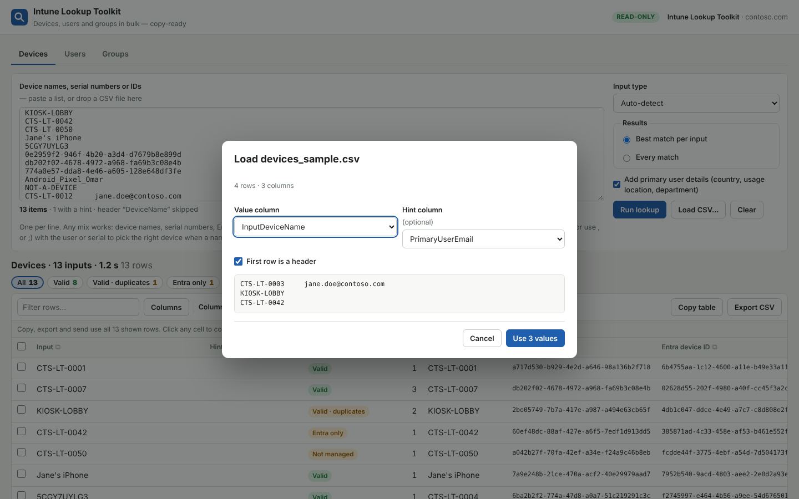 **Load your existing CSV files** |
| 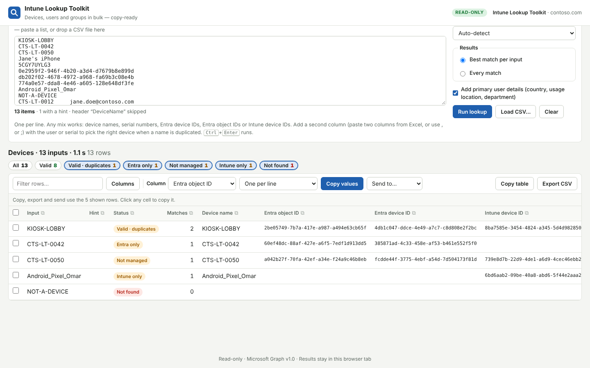 **Every input that isn't Valid, in two clicks** | 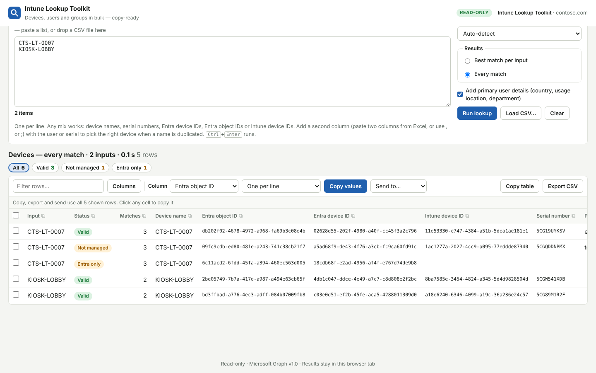 **Every match: stale objects and old records** |
| 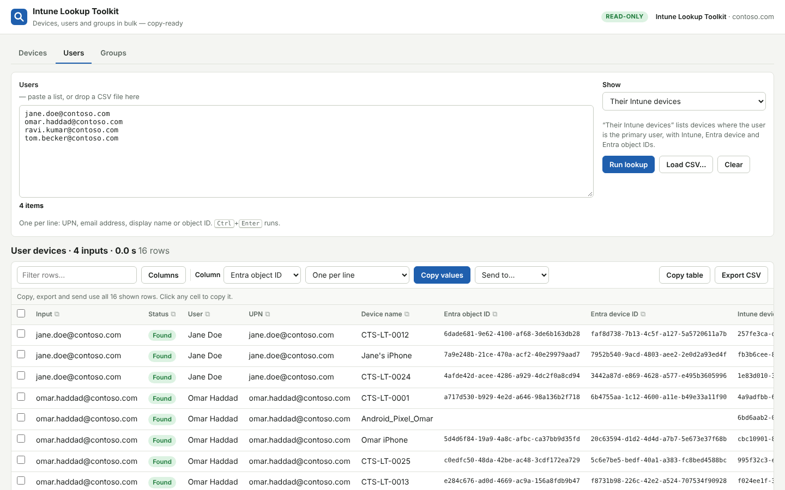 **Group members → their devices with Send to…** | 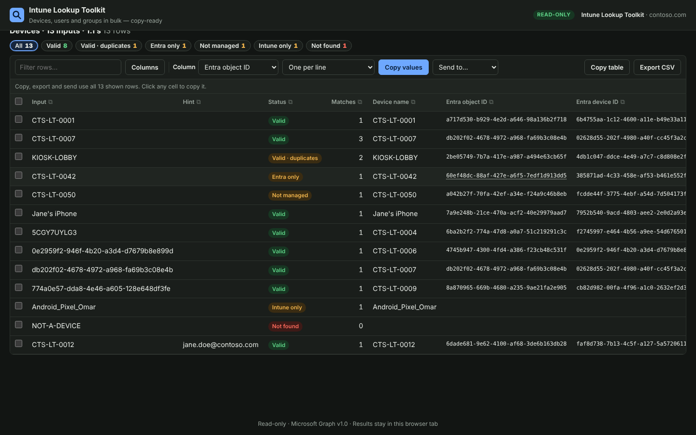 **Dark mode** |
| 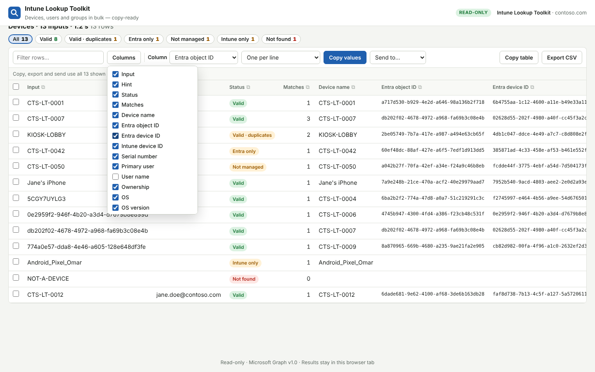 **Pick the columns you need** | 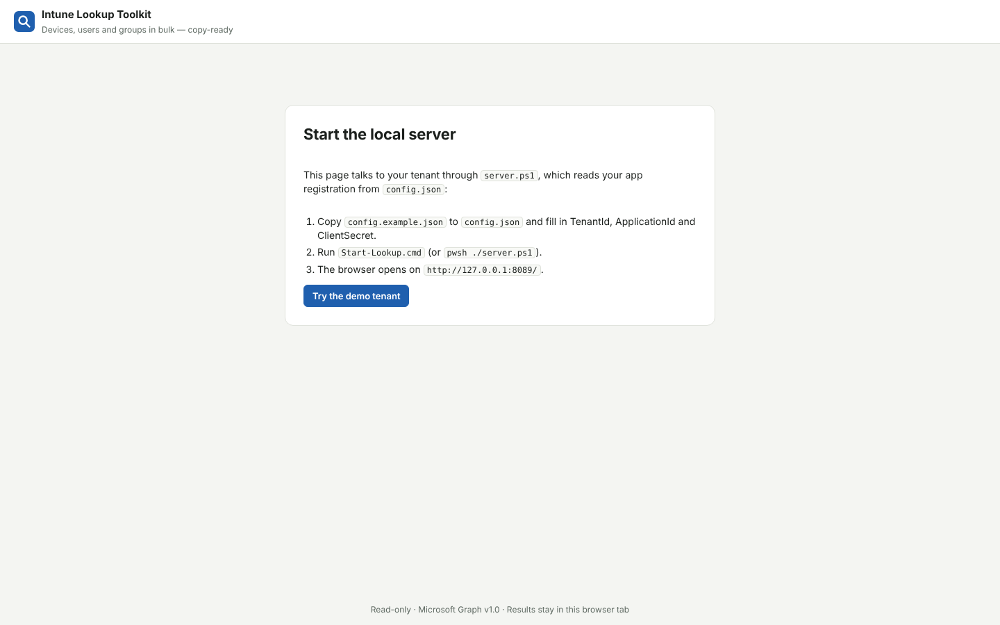 **Start screen** |

## Documentation

- [Requirements](docs/REQUIREMENTS.md)
- [Setup & troubleshooting](docs/SETUP.md)
- [User guide & recipes](docs/USER-GUIDE.md)
- [Security model](docs/SECURITY-MODEL.md)
- [Changelog](CHANGELOG.md) · [Contributing](CONTRIBUTING.md) · [Security policy](SECURITY.md)

## Part of the Exentis Intune toolkit

Built and maintained by [Marwen Mahmoud](https://github.com/exentis-tech). Companion tool: **[Intune App Decommission](https://github.com/exentis-tech/intune-app-decommission)** — retire old app packages, their assignments and groups in bulk, using the same `config.json`.

## License

[MIT](LICENSE). Provided as is, without warranty.
