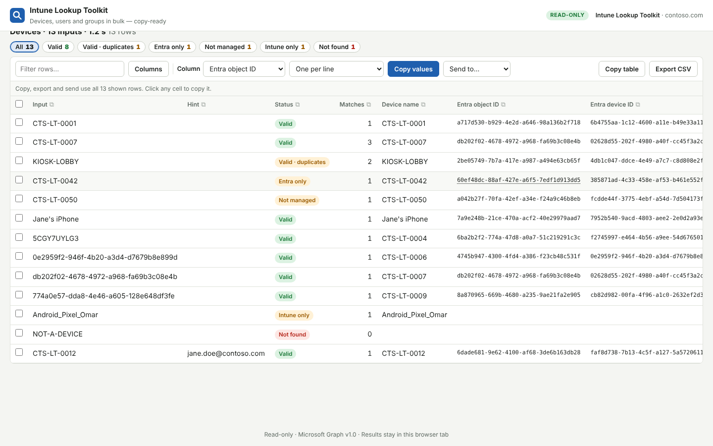

# User guide

Screenshots use a fictitious *Contoso* tenant.

- [Input: paste, hint column, CSV](#input-paste-hint-column-csv)
- [Devices](#devices)
- [Users](#users)
- [Groups](#groups)
- [Working with results](#working-with-results)
- [Recipes](#recipes)

## Input: paste, hint column, CSV

Every tool takes **one value per line**. Blank lines and lines starting with `#` are ignored, duplicates are removed, and a first line that is just a column name (`DeviceName`, `Email`, `SerialNumber`…) is skipped — so you can paste a column straight from Excel including its header. The counter under the box shows how many items will run. **Ctrl+Enter** runs the lookup.

**Hint column (Devices).** Paste two columns from Excel, or separate with Tab, `;` or `,`, to add a hint to each value — the primary user or the serial number. When several devices share a name, the one matching the hint wins:

```
LAPTOP-0007	jane.doe@contoso.com
KIOSK-LOBBY;5CG1234ABC
```

**Load CSV…** (or drag a file onto the box) opens your existing CSV exports. Pick the **value column** and optionally a **hint column**; the tool pre-selects likely columns (`DeviceName`, `SerialNumber`, `PrimaryUserEmail`, `Email`…) and shows a preview.


## Devices


Paste any mix of **device names, serial numbers, Entra device IDs, Entra object IDs and Intune device IDs**.

| Option | Meaning |
|---|---|
| **Input type** | *Auto-detect* (default): GUIDs are tried as Entra object ID, Entra device ID and Intune device ID; anything else as device name (Entra + Intune) and serial number. Force a type to avoid ambiguity. |
| **Best match per input** | One row per input: the best record, with *Matches* and a *Note* explaining the choice. |
| **Every match** | One row per record found — useful to see stale objects and old Intune records. |
| **Add primary user details** | Adds the primary user's country, usage location and department (more in *Columns*). |

**How the best match is chosen** — records are ranked by: matches the hint → actively managed in Intune → Entra and Intune linked → Entra object enabled → most recent check-in / sign-in.

**Statuses**

| Status | Meaning |
|---|---|
| **Valid** | Entra object linked to an actively managed Intune device |
| **Valid · duplicates** | Several valid matches; best shown — add a hint to pick one |
| **Not managed** | Intune record exists but isn't actively managed (retire / wipe pending) |
| **Entra only** | Entra device without an Intune record |
| **Intune only** | Intune device without an Entra object |
| **Not found** | Nothing matches |
| **Invalid input** | The value isn't valid for the forced input type (e.g. not a GUID) |
| **Error** | A Graph call failed; the *Note* says why |

**Columns available:** Input, Hint, Status, Matches, Device name, Entra object ID, Entra device ID, Intune device ID, Serial number, Primary user, User name, Ownership, OS, OS version, Compliance, Management state, Registration state, Last check-in, Enrolled, Model, Manufacturer, Entra enabled, Join type, Entra last sign-in, Found by, Note — plus User country / usage location / department / office / city / job title with *Add primary user details*.



## Users


Paste **UPNs, email addresses, display names or object IDs**. An email is matched against both UPN and mail, so `paul.martin@contoso.fr` finds `paul.martin@contoso.com`.

- **User details & location** — display name, UPN, mail, object ID, country, usage location, city, department; *Columns* adds office, job title, company, employee ID, SAM account name, enabled, created.
- **Their Intune devices** — one row per device where the user is **primary user**, with Intune device ID, Entra device ID, **Entra object ID**, serial, ownership, OS, compliance and last check-in.

Statuses: **Found**, **Disabled** (account disabled), **Multiple users** (the name matched several — use the UPN), **No devices**, **Not found**, **Error**.


## Groups


Paste **group names or object IDs**. Choose **Users**, **Devices** or both, and whether to **include members of nested groups**. Each member appears once, with every group it came from in *Source groups*. The chips above the table show each group with its member count, and say which names weren't found.

Copy the **Email or UPN** column (mail when set, otherwise UPN) for a mailing list, or **Object ID** for another tool.

## Working with results


| Action | How |
|---|---|
| Filter by status | Click a status chip; **Ctrl+click** to combine several; *All* to reset |
| Filter by text | *Filter rows…* matches any visible column |
| Sort | Click a column header (again for descending, a third time to clear) |
| Show / hide columns | **Columns** — your choice is remembered per tool |
| Copy one value | Click the cell |
| Copy a whole column | Click **⧉** in its header, or pick it in *Column* and click **Copy values** — unique values only |
| Copy format | One per line · comma-separated · `'quoted'` for PowerShell / KQL · `"double-quoted"` for JSON |
| Copy only some rows | Tick rows (**Shift+click** selects a range); copy, export and send then use only those |
| Copy to Excel | **Copy table** (tab-separated, with headers) |
| Save | **Export CSV** (UTF-8, opens in Excel, formulas neutralised) |
| Chain lookups | Pick a column and **Send to…** another tool |

The line above the table always says what copy / export / send will use (selected rows, or all shown rows). Large results show the first 500 rows on screen; copy and export include every row.


## Recipes

| Goal | Steps |
|---|---|
| **Entra object IDs for a list of device names** (e.g. to add them to a group) | Devices → paste names → Run → status chip **Valid** → ⧉ on *Entra object ID* |
| **Object IDs from Intune device IDs** | Devices → paste IDs (auto-detected) → ⧉ *Entra object ID* |
| **Which devices failed?** | Devices → click every non-Valid chip (Ctrl+click) → **Copy table** |
| **Country of each device's user** | Devices → tick *Add primary user details* → Columns: *User country*, *User usage location* |
| **Devices of a list of users** | Users → *Their Intune devices* → paste emails → Run |
| **All devices of a group's users** | Groups → Users → Run → Column *UPN* → **Send to… Users lookup** → *Their Intune devices* → Run |
| **Emails of everyone in nested groups** | Groups → Users, nested → Run → ⧉ *Email or UPN* |
| **Serial numbers for a hardware refresh** | Devices → paste names → ⧉ *Serial number* |
| **Fix a duplicate name** | Paste `NAME<TAB>user@contoso.com` or `NAME;SERIAL` |
